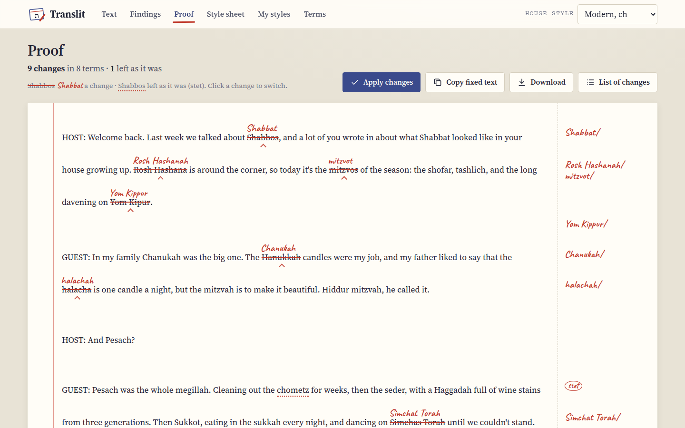
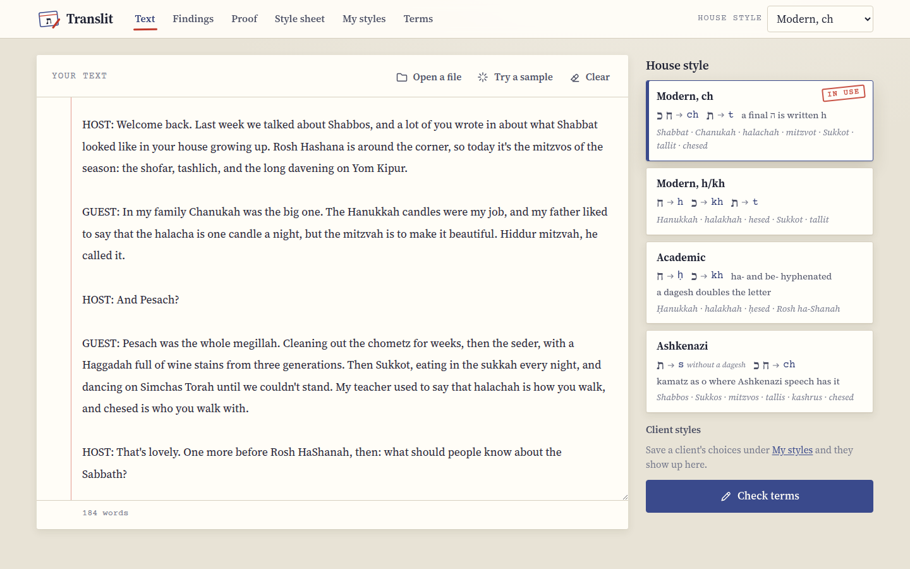
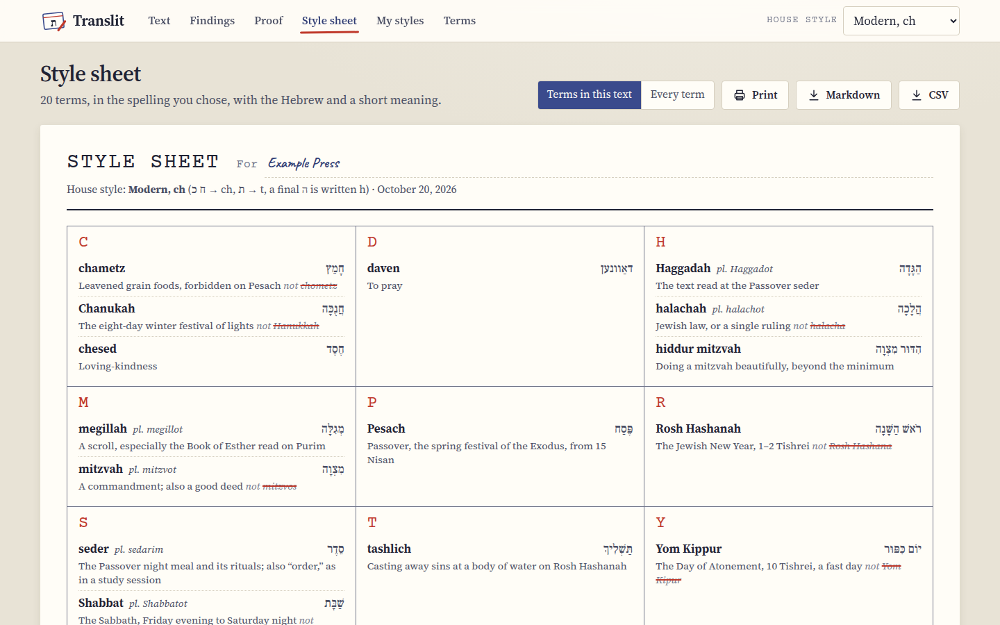
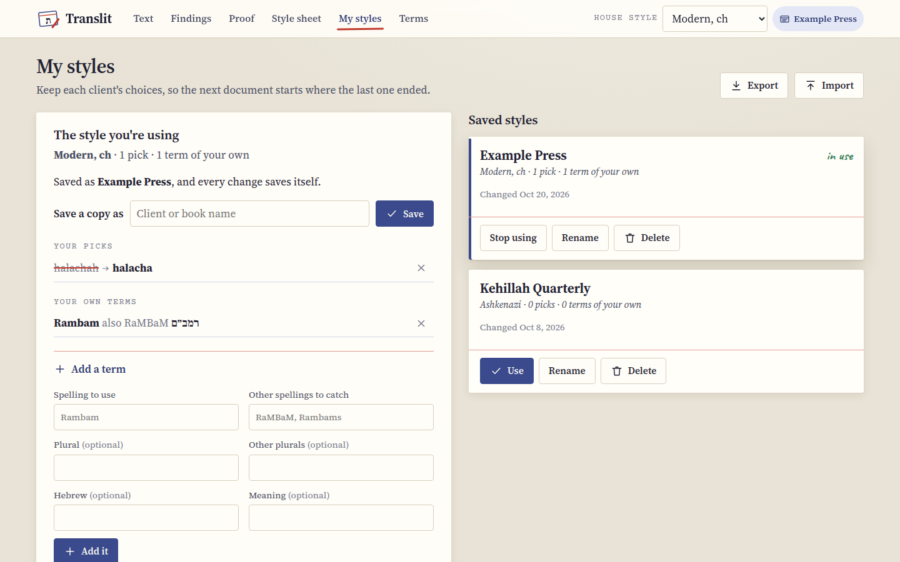

<p align="center">
  
</p>
<h1 align="center">Translit</h1>
<p align="center"><b>Make every Shabbat, Chanukah and halacha in a document spelled the same way, in the style you choose.</b><br>For editors, transcribers and translators of English texts full of Hebrew and Yiddish words.</p>
<p align="center">
  
  
  
  
  
  
</p>
<p align="center">
  <a href="docs/README.md"><b>Docs</b></a> ·
  <a href="#use-it">Use it</a> ·
  <a href="#what-it-does">What it does</a> ·
  <a href="#screenshots">Screenshots</a> ·
  <a href="docs/house-styles-and-terms.md">The house styles</a>
</p>

<picture>
  <source media="(prefers-color-scheme: dark)" srcset="docs/images/findings-dark.png">
  
</picture>

Translit reads an English text, finds every Hebrew and Yiddish term it knows in every spelling it's
written in, and shows you where the text doesn't agree with itself. Then it fixes the lot to the house
style you pick, marks every change in red the way a proofreader would, and hands you a style sheet for
the client.

## Why I made it

I edit, transcribe and translate English texts that are full of Hebrew and Jewish words: podcast
transcripts, books, articles. The same word turns up spelled three ways in one document (Shabbat on
page one, Shabbos on page four, Shabbes in a quote), and every client wants their own house style.
Some want Chanukah and halachah, some want Hanukkah and halakhah, some want Shabbos and mitzvos, and
a few want Ḥanukkah with the dot.

Find and replace doesn't really do it, because you have to know every spelling before you search for
it, and it happily changes Rosh Hashanah into something strange while it's fixing "shanah". So I made
a tool that already knows the spellings, keeps the capitals at the start of a sentence, handles
plurals and possessives, and lets me look over every change before it goes in.

It's free, there's no account, and the text never leaves your browser, which matters when it's a
client's manuscript.

## What it does

### Checking a text
- **Paste or open** a .txt or .md file, or **Try a sample** to see how it works.
- **Four house styles** with their rules shown: Modern ch (Shabbat, Chanukah, halachah), Modern h/kh
  (Hanukkah, halakhah, hesed), Academic (Ḥanukkah, Rosh ha-Shanah) and Ashkenazi (Shabbos, Sukkos,
  mitzvos, tallis).
- **Findings** puts every term it found on an index card, with each spelling and how many times it
  appears. Terms spelled more than one way come first, marked "mixed!".
- **Choose per term:** the house style's form, any spelling it found, or one you type.
- **English equivalents** (Sabbath, Passover, Pentecost) are counted but left alone, unless you tick
  **Change these too**.

### Fixing it
- **Proof** shows your text with every change struck through and the new spelling written above in red,
  with notes in the margin.
- **Stet:** click a change to leave that one as it was.
- **Apply changes**, **Copy fixed text** or **Download**, and a **List of changes** as a spreadsheet.
- **Careful matching:** whole words only, plurals (mitzvot, mitzvos, mitzvahs), possessives (Shabbos's),
  hyphens and spaces (Rosh Hashana, Rosh HaShanah, Rosh ha-Shanah), and capitals at the start of a
  sentence. The longest term wins, so Rosh Hashanah is never read as "shanah". Links are skipped.

### Style sheets and client styles
- **Style sheet:** the terms in your text (or every term) in the spelling you chose, with the Hebrew
  and a short meaning, set out in alphabetical boxes like an editor's style sheet. **Print** it, or get
  it as **Markdown** or **CSV**.
- **My styles:** save a client's choices under their name, and the next document starts where the
  last one ended.
- **Your own terms:** add names and words the list doesn't know, with the spellings to catch.
- **Export** and **Import** your styles as a JSON file, to move them to another computer.

### The term list
- **383 terms** in nine groups: holidays and months, Shabbat and prayer, texts and study, ritual
  objects, life cycle, food, concepts and values, people and titles, and everyday Yiddish (with YIVO
  forms for the academic style).
- Each one has the Hebrew with niqqud, a one-line meaning, every spelling I know of, and the form for
  each house style. **Terms** lets you search them all, in English or in Hebrew.

## Screenshots

<picture>
  <source media="(prefers-color-scheme: dark)" srcset="docs/images/proof-dark.png">
  
</picture>

*Proof: every change marked the way a proofreader marks a page.*

<picture>
  <source media="(prefers-color-scheme: dark)" srcset="docs/images/phones-dark.png">
  
</picture>

*On a phone: the text, the Findings and the Proof.*

<details>
<summary>More screenshots</summary>

<picture>
  <source media="(prefers-color-scheme: dark)" srcset="docs/images/text-dark.png">
  
</picture>

*The text and the four house styles, each with its rule.*

<picture>
  <source media="(prefers-color-scheme: dark)" srcset="docs/images/sheet-dark.png">
  
</picture>

*The style sheet, ready to print or send.*

<picture>
  <source media="(prefers-color-scheme: dark)" srcset="docs/images/styles-dark.png">
  
</picture>

*My styles, with a client's picks and a term of their own.*

<picture>
  <source media="(prefers-color-scheme: dark)" srcset="docs/images/terms-dark.png">
  
</picture>

*Terms: every term in all four styles, with the spellings it catches.*

</details>

## Use it

Translit is one web page. Open **https://stuffs.tiresia.xyz/translit/** in any up-to-date browser on
a computer, tablet or phone, paste a text and press **Check terms**. It's free and there's no account.
On a phone or tablet you can add it to your Home Screen from the browser's Share menu, and it opens
like an app.

Everything happens in your browser. Your text, your picks and your client styles are kept in that
browser's storage on your own device, and nothing is sent anywhere.

## Documentation

The docs walk through Translit in the order you'd use it:

- **Getting started:** [What is Translit?](docs/what-is-translit.md)
- **Using Translit:** [Checking a text](docs/checking-a-text.md), [Proofing and fixing](docs/proofing-and-fixing.md)
  and [Style sheets and client styles](docs/style-sheets-and-client-styles.md)
- **Reference:** [The house styles and the terms](docs/house-styles-and-terms.md)
- **Under the hood:** [Developing](docs/DEVELOPING.md)

Start with [What is Translit?](docs/what-is-translit.md)

## How it's built

Plain HTML, CSS and JavaScript modules in `app/`, with no framework and no build step. Any web server
that can serve a folder can host it.

| File | What |
|---|---|
| `app/index.html`, `app/style.css` | The page: the six screens, light and dark, phone to wide screen, and a print layout for the style sheet. |
| `app/main.js` | The screens, the cards, the proof marks, saving and the exports. |
| `app/matcher.js` | Finding the terms and planning the fixes. Pure functions, no page needed. |
| `app/data/terms.json` | The term list, one term per line. Adding a term never touches the code. |
| `app/store.js`, `app/export.js` | Local storage, the styles file, and the Markdown, CSV and download helpers. |
| `tools/` | The tests, the data check, the screenshot walk, the icon and the deploy script. |

The tests run in headless Chrome:

```
tools/check_terms.py     # the term list: no spelling claimed twice, every style form is a spelling
tools/test.py            # the matcher: plurals, possessives, capitals, overlaps, and every spelling in the list
tools/walk.py OUT_DIR    # clicks through every screen, checks it, and screenshots each step
```

[Developing](docs/DEVELOPING.md) has the details.

## Credits

- **Fonts** in `app/fonts/`, each with its licence next to it, all under the SIL Open Font License 1.1:
  [Source Serif 4](https://github.com/adobe-fonts/source-serif) for the text,
  [Frank Ruhl Libre](https://github.com/fontef/frankruhllibre) for the Hebrew,
  [Caveat](https://github.com/googlefonts/caveat) for the red pencil and
  [Courier Prime](https://github.com/quoteunquoteapps/CourierPrime) for the typed labels.
- **The term list** was written for Translit and is under the same MIT License as the code. The forms
  I'm least sure of are marked in the app and listed in [REVIEW.md](REVIEW.md).
- **The proofreading marks** (the caret, the strike-through, stet, the query) are the editor's old
  conventions, borrowed with thanks.

The same list is in [NOTICE](NOTICE).

## License

Translit is MIT licensed, see [LICENSE](LICENSE).
