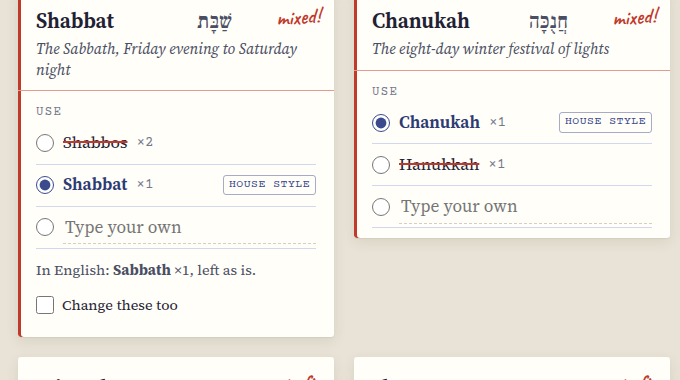

[Translit docs](README.md) › Using Translit

# Checking a text

This page is about getting a text in, picking a house style, and reading the Findings cards, which is
where you make all your choices. Proofing and applying the changes have their own page.

## Getting the text in

The **Text** screen is a sheet of paper. Paste your text onto it, or press **Open a file** and pick a
.txt or .md file (or drop one onto the page on a computer). **Try a sample** loads a short made-up
podcast transcript with the usual mix of spellings, which is the quickest way to see what Translit
does. **Clear** empties the page, and the message that pops up has an **Undo** in case you didn't mean it.

*The text on the left, the house styles on the right.*

Translit keeps the last text you worked on, so if you close the tab and come back, it's still there.

## Picking a house style

The four cards beside the text are the house styles. Each one shows its rule (ח and כ as ch, for
example) and a few words the way it writes them, which is usually enough to tell which one a client
means when they say "the way we always do it". The one with the red "in use" stamp is the one
Translit fixes the text to, and you can also switch styles from the **House style** menu at the top of
every screen.

If you've saved a client's style under My styles, it shows up under "Client styles" here, and choosing
it brings back all of that client's choices at once.

When you're ready, press **Check terms**.

## The Findings cards

Findings puts every term it found on its own index card. The line at the top says how many terms it
found, how many are spelled more than one way, and how many changes the current choices would make.

*Shabbos twice and Shabbat once: two spellings of one word, so the card says "mixed!".*

Each card has the spelling it will use in large type, the Hebrew beside it, and a one-line meaning.
Underneath, under "Use", are the spellings the text actually has, each with how many times it appears.
The one with the filled circle is the one Translit will write everywhere. Spellings that are going to be
replaced are struck through in red, and the one your house style uses is marked "house style" even if
the text never uses it.

The red note in the corner of each card tells you where it stands: "mixed!" when the text spells the
term more than one way, "2 to fix" when it's consistent but not in your house style, and a green "ok"
when there's nothing to do. Cards marked "mixed!" come first, because they're the ones a reader would
notice.

## Making a choice

To use a different spelling for one term, tap it. That's all, and the struck-through spellings and the
count of changes update straight away. Tapping the house style spelling again puts the term back to
the default. If you want a spelling that isn't on the card, choose **Type your own** and write it in,
and press Enter (or just move on).

A choice applies to that term only, which is how you make a house style your own: Modern ch for
everything, say, but Shabbos for Shabbat because the client is Ashkenazi about that one word. Your
choices are remembered, and if you save them as a client style they come back the next time you use it.

Terms with a plural have a second set of spellings under "Plural", chosen the same way. Mitzvot,
mitzvos and mitzvahs are all plurals of mitzvah, so they're counted together and fixed to the plural
you pick, while a plain English plural like Torahs simply keeps its s on whatever spelling you choose.

## English words

Some terms have English equivalents, like Sabbath for Shabbat or Passover for Pesach. Translit counts
them and shows them on the card ("In English: Sabbath ×1, left as is"), but it doesn't change them,
because a translator usually means them. If a client wants them gone, tick **Change these too** on that
card and they're fixed to the Hebrew term like any other spelling. And if a client wants the English,
choose **Type your own** and write Passover, and every Pesach becomes Passover instead.

## Capitals

Translit keeps capitals where a sentence needs them, so "Halacha is clear" becomes "Halachah is clear"
and a word in capitals stays in capitals. The **Capitals** menu above the cards decides what happens
to a capital in the middle of a sentence.

**Keep the text's** is the default, and it leaves a capital alone, which means "the Megillah" and "the
whole megillah" both come out the way they went in, only spelled right. **Follow my spelling** writes
the term the way your chosen spelling is capitalized (except at the start of a sentence or in a
heading), which is what you want when a transcriber capitalized words at random. With that one on, a
stray capital also shows up on the card as a spelling of its own, so you can see how many there were.

## The filters

**All**, **Mixed**, **Will change** and **Fine** above the cards show just those piles, which helps in a
long text with fifty terms. The numbers on them are how many cards are in each.

## Next step

When the cards look right, press **Proof it**, and [Proofing and fixing](proofing-and-fixing.md) is next.

Next: [Proofing and fixing](proofing-and-fixing.md) →
