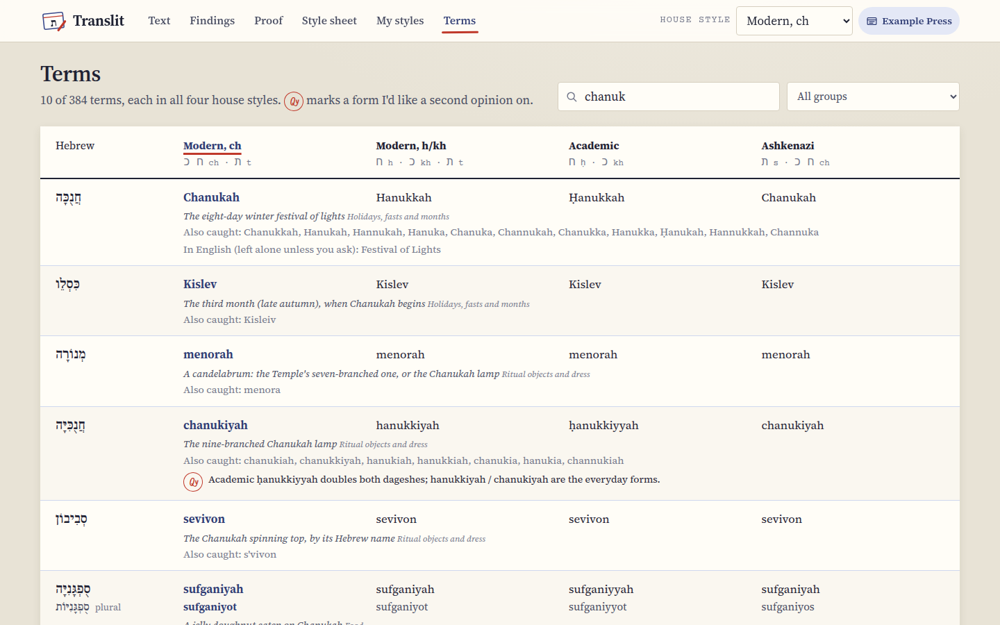

[Translit docs](README.md) › Reference

# The house styles and the terms

This is the reference page: what each house style does, what's in the term list, how the matching
works, and what Translit leaves alone on purpose. You don't need it to use Translit, but it's the page
to look at when a word comes out differently from what you expected.

## The four house styles

A house style here is a set of habits more than a strict scheme, because that's how publishers work:
each style follows its rule, and bends where English has settled on a spelling everyone uses.

**Modern, ch.** Israeli and Sephardi pronunciation, the way many Orthodox and Israeli publishers write
in English.
- ח and כ are written **ch**, ת is **t**, and a final ה is written **h**.
- Shabbat, Chanukah, halachah, mitzvot, Sukkot, tallit, chesed, Rosh Hashanah.

**Modern, h/kh.** Common in general-audience writing and a lot of academic-lite writing.
- ח is **h**, כ is **kh**, ת is **t**.
- Hanukkah, halakhah, hesed, Sukkot, tallit, Pesah.
- Words English has settled on keep their ch: challah and chutzpah.

**Academic.** For scholarly writing.
- ח is **ḥ** (h with a dot under it), כ is **kh**, and prefixes are hyphenated (ha-, be-).
- A dagesh that doubles a letter is shown by doubling it: Ḥanukkah, Iyyar, kavvanah.
- Ḥanukkah, halakhah, ḥesed, Rosh ha-Shanah, Tishah be-Av.
- Yiddish words use the YIVO romanization: yarmlke, bobe, shtetlekh, tsholnt.

**Ashkenazi.** As in much Orthodox Ashkenazi and yeshivish writing.
- ת without a dagesh is **s**, ח and כ are **ch**.
- The kamatz is **o** where that's how the word is usually written: Shabbos, chometz, seforim,
  Yisroel. Elsewhere it stays a (yetzer hara, Yamim Noraim), and the spoken o-forms are still caught
  and fixed.
- Shabbos, Sukkos, mitzvos, tallis, kashrus, chesed, Bircas Hamazon.

If a client's habits differ on a word or two, pick their spelling on that card and save it as their
client style. That's what the picks are for.

## The term list

There are 383 terms, in nine groups you can filter by on the **Terms** screen:

- Holidays, fasts and months
- Shabbat and prayer
- Texts and study
- Ritual objects and dress
- Life cycle
- Food (including the Yiddish dishes)
- Concepts and values
- People and titles
- Everyday Yiddish

Every term has the Hebrew (with niqqud, or the Yiddish spelling for Yiddish words), a one-line meaning,
every spelling I know of, and the form for each house style, with the plural where a Hebrew plural is
normal in English. The Terms screen shows all four forms side by side, the current style highlighted,
and the spellings each term catches. You can search in English or in Hebrew, with or without niqqud.

*A search finds a term by any of its spellings, its meaning or its Hebrew.*

A red **Qy** (the proofreader's "query") marks a form I'd like a second opinion on, with the question
next to it. They still work like any other term.

## How the matching works

- **Whole words only.** Chesed is found on its own, never inside Chesedville.
- **Any capitals.** Shabbos, shabbos and SHABBOS are all found. When it fixes them, Translit keeps
  capitals at the start of a sentence, in headings and in all-capital words.
- **Spaces and hyphens.** Rosh Hashanah, Rosh-Hashanah, Rosh HaShanah, Rosh ha-Shanah and a Rosh
  Hashanah broken across two lines are all the same term (and still counted as different spellings, so
  you can see them).
- **Apostrophes.** Straight or curly, and optional: Ta'anit and Taanit are both found.
- **Plurals.** Hebrew plurals are their own spellings (mitzvot, mitzvos, mitzvahs, all fixed to the
  plural you choose). An English -s or -es is kept on whatever spelling you choose (Torahs, shuls, and
  Shabbats becomes Shabboses in the Ashkenazi style).
- **Possessives.** Shabbos's, the Rebbe's, the Rebbes', and Sukkos' all keep their endings, and
  Sukkos' end becomes Sukkot's end in a modern style.
- **Yiddish verbs** keep their English endings: davening, davened, schlepping, kvelling.
- **The longest term wins.** Rosh Hashanah is one term, not Rosh plus "shanah", and bar mitzvah,
  Simchat Torah, kiddush Hashem and talmid chacham aren't split into their parts.
- **ḥ with a dot** is found whether it was typed as one character or as an h plus a combining dot.

## What it leaves alone on purpose

- **Web addresses and email addresses.**
- **Words that are also English or names:** Cohen, hag (the h/kh form of chag is never searched for),
  shames, bench, moil, tales, din. They'd cause more trouble than they'd fix.
- **Names of people.** Bare names (Avraham, Moshe, Yitzchak) aren't in the list, so real people's names
  are never changed. Fixed phrases like Avraham Avinu and Moshe Rabbeinu are.
- **A Brit, Shiva, and Av in capitals.** brit and shiva are only found in lowercase (or at the start of a
  sentence), and the month Av only as Av, so a Brit in London, the Hindu god and an AV club stay as
  they are.
- **Fixed phrases** with their own entries: Gut Shabbos, Good Shabbos, Shabbat Shalom and matzo ball are
  kept as they are in every style, so a modern style doesn't turn Gut Shabbos into "Gut Shabbat".
- **English equivalents** (Sabbath, Passover, Pentecost, phylacteries), unless you tick
  **Change these too** on the card.
- **Sukkot and sukkot.** The festival and the plural of sukkah have the same letters, so Translit tells
  them apart by the capital: Sukkot is the festival and sukkot the booths.

## Next step

If a term is missing or spelled in a way you wouldn't, add it under My styles for now (see
[Style sheets and client styles](style-sheets-and-client-styles.md)), and open an issue on the GitHub
repo so it can go into the list for everyone.
