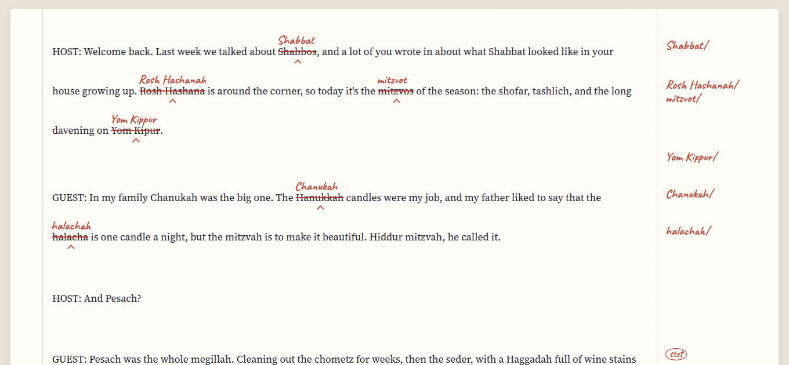

[Translit docs](README.md) › Using Translit

# Proofing and fixing

This page is about the **Proof** screen: reading the marked-up text, leaving single changes out, and
getting the fixed text back out of Translit.

## The marked-up text

Proof shows your whole text on a sheet of paper with every change marked the way a proofreader marks a
page. The old spelling is struck through in red, the new one is written above it in red pencil with a
small caret under the word, and on a computer the same correction is repeated in the margin, so you can
run your eye down the right-hand side and see every change on a page at a glance.

*Shabbos becomes Shabbat, Rosh Hashana becomes Rosh Hashanah, and the margin says so too.*

The line above the paper says how many changes there are and in how many terms. Nothing has changed in
your text yet. Proof is only a preview until you press **Apply changes**.

## Stet: leaving one as it was

Sometimes one occurrence should stay the way it is: a quotation, a book title, a name, or a Yiddish
greeting in the middle of a modern-spelled text. Click (or tap) that change and it's marked "stet", the
proofreader's word for "let it stand". The strike-through turns into a dotted line under the word, the
margin says stet in a circle, and that one is left out when you apply. Click it again to change it after
all.

A stet belongs to this proof only. If you change a choice on the Findings cards, the changes are worked
out again and the stets start over.

## Applying the changes

**Apply changes** writes every change that isn't a stet into your text, and the Text screen now has the
fixed version. A message pops up with an **Undo**, which puts the text back exactly as it was if you
change your mind. After applying, Proof shows only what's left, which is usually nothing but your stets.

You don't have to apply to get the fixed text out, though. **Copy fixed text** puts the text with the
changes (and without the stets) on the clipboard, ready to paste back into your document, and
**Download** saves it as a file. If you opened a file, the download has the same name with "-fixed" on
the end, so a Markdown file stays a Markdown file.

## The list of changes

**List of changes** downloads a spreadsheet (a CSV file) with one row per change: the line it's on, the
spelling before, the spelling after, the term, and whether it was changed or left as it was. It's handy
to send along with the fixed text, so the client can see what was done without comparing two
documents, and it opens in Excel, Numbers or Google Sheets.

The same list is at the bottom of the Proof screen, under **Every change**, if you just want to look.

## What it won't touch

Translit only changes the terms it knows, and only whole words, so "chesed" inside "Chesedville" is
left alone, and so is anything inside a web address or an email address. Fixed phrases are protected
by their own entries: Gut Shabbos stays Gut Shabbos even in a modern-spelled text, and matzo ball soup
keeps its matzo. [The house styles and the terms](house-styles-and-terms.md) has the whole list of
things it leaves alone on purpose.

Basically, nothing happens to your text that you haven't seen in red first.

## Next step

When the text is done, the style sheet for the client is one tab over, and
[Style sheets and client styles](style-sheets-and-client-styles.md) explains it.

Next: [Style sheets and client styles](style-sheets-and-client-styles.md) →
