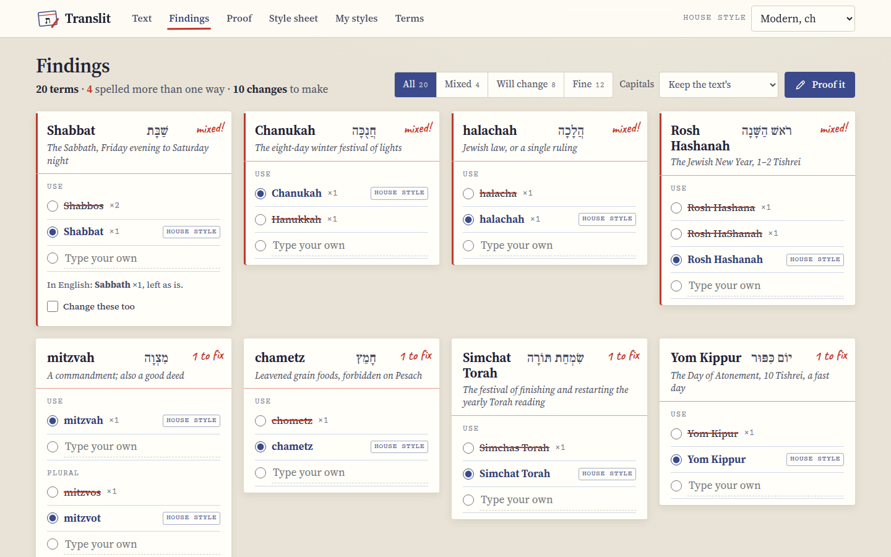
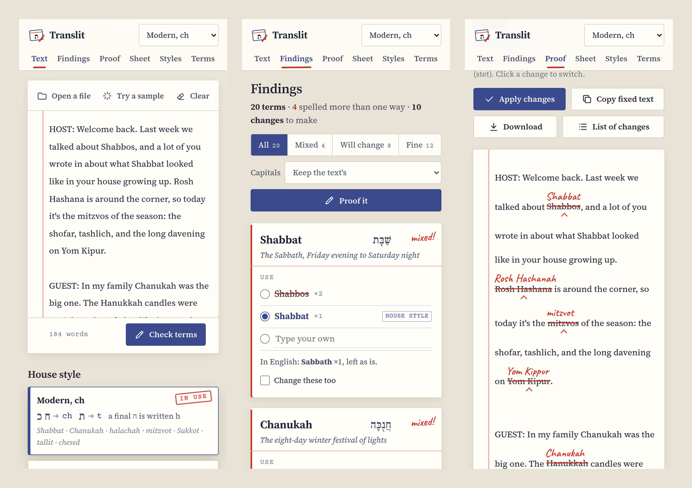

[Translit docs](README.md) › Getting started

# What is Translit?

Translit is a web page that makes the Hebrew and Yiddish words in an English text all spelled the same
way. You paste in a transcript, a chapter or an article, pick a house style, and it finds every term it
knows in every spelling it's written in, shows you where the text disagrees with itself, and fixes it
in one go. It runs in the browser on a computer, a tablet or a phone, and the text never leaves your
device.

*Findings: one index card per term, with every spelling the text uses.*

## What it does

Say a transcript has Shabbos in one paragraph, Shabbat in the next and "the Sabbath" in a question from
the audience. Translit notices all three, puts them on one card under Shabbat, and tells you the first
two are the same word spelled two ways. You choose how it should be spelled: the form your house style
uses, one of the spellings it found, or something you type. Then the **Proof** screen shows your text
with every change marked in red, the way a proofreader marks a page, and you can leave any single one
as it was. When it looks right, **Apply changes**, and copy or download the result.

It also makes the style sheet I'd otherwise put together by hand at the end of a job: every term in the
text in the spelling you chose, with the Hebrew and a short meaning, ready to print or send to the
client. And it remembers each client's choices, so the next document from the same client starts where
the last one ended.

Basically, it's the editor's style sheet and red pencil, with the boring half done for you.

## Who it's for

I made it for anyone who edits, transcribes or translates English texts full of Jewish terms: podcast
and lecture transcripts, books, articles, synagogue newsletters, school materials. It's most useful when
a text has been through more than one pair of hands, or when different clients want different spellings
of the same words.

## The house styles

Translit knows four house styles, and every term has a form for each one:

| Style | The rule | Looks like |
|---|---|---|
| **Modern, ch** | ח and כ as ch, ת as t | Shabbat, Chanukah, halachah, mitzvot, Sukkot, tallit, chesed |
| **Modern, h/kh** | ח as h, כ as kh, ת as t | Hanukkah, halakhah, hesed, Sukkot, tallit |
| **Academic** | ח as ḥ, כ as kh, ha- and be- hyphenated | Ḥanukkah, halakhah, ḥesed, Rosh ha-Shanah |
| **Ashkenazi** | ת without a dagesh as s, kamatz as o where it's usually written that way | Shabbos, Sukkos, mitzvos, tallis, kashrus, chesed |

[The house styles and the terms](house-styles-and-terms.md) has the details, including the cases where
the rule bends to how people really write.

## Where it works

Translit is one web page, so it works in any up-to-date browser. On a computer you get the whole page at
once, with the proof marks repeated in the margin. On a phone the same screens stack up, and the marks
stay in the text. I've checked it in Chrome on a computer and at phone size, which is also how the
screenshots in these pages were made.

*The same three screens on a phone.*

If you'd like it on your Home Screen, open it in Safari on an iPhone or iPad, tap **Share** and choose
**Add to Home Screen**, and on Android use the browser menu. It then opens like an app.

## What stays on your device

Everything. Translit doesn't upload your text, there's no account, and there's nothing on the page that
talks to anyone else. The only things it downloads are its own files: the page, its fonts and the term
list.

What you do is kept in your browser's storage for the page, on your own device: the last text you
worked on, your choices, and your saved client styles. That also means they don't move between devices
by themselves, and clearing the site's data in the browser deletes them. **Export** under My styles
saves your client styles to a file, which you can **Import** somewhere else. In a private window, or
anywhere the browser won't keep storage, Translit still works, and your choices last until you close
the window.

## Next step

Open Translit, press **Try a sample**, and then [Checking a text](checking-a-text.md) walks you through
what you're looking at.

Next: [Checking a text](checking-a-text.md) →
